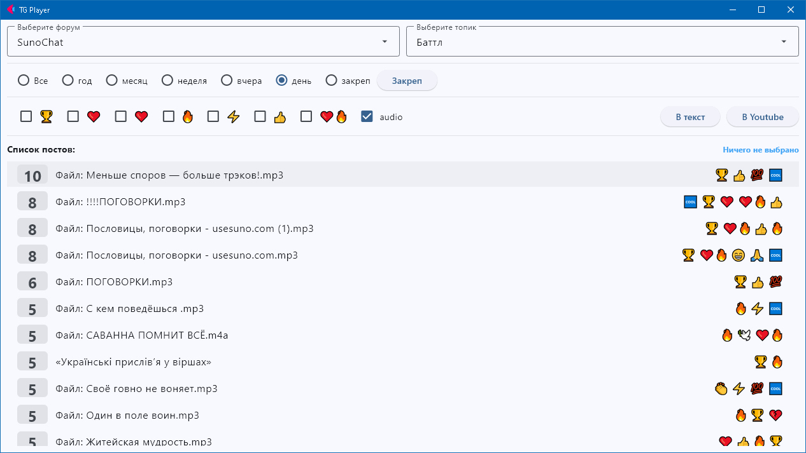

# tg_player


## Download
Windows 10/11: [tg_player-1.5.zip](https://github.com/vitalfadeev/tg_player/releases/download/1.5/tg_player-1.5.zip)

## Command line options
```
--proxy=auto 
--proxy=direct
--proxy=mtproto
--proxy=none
```

## Фильтр
### по времени

- все - все треки
- год - с начала текущего года (с 1 января с 00:00)
- месяц - с начала текущего месяца (с 00:00)
- неделя - с дня  7 дней назад с (00:00)
- вчера - с начала вчера до конца вчера (с 00:00 до 23:59:59)
- день - с начала дня  (с 00:00)
- закреп - с закрепа до закрепа, или по последнее сообщение

### по реакциям

- все галочки сняты - все треки
- 🏆 - только с 🏆
- 🏆,❤️ - только с 🏆,❤️
- и т.д.

### аудио

- аудио - только с файлом (mp3,m4а,wav,...)

## Автоматический режим

Пример в [batch-battle.bat](batch-battle.bat)
